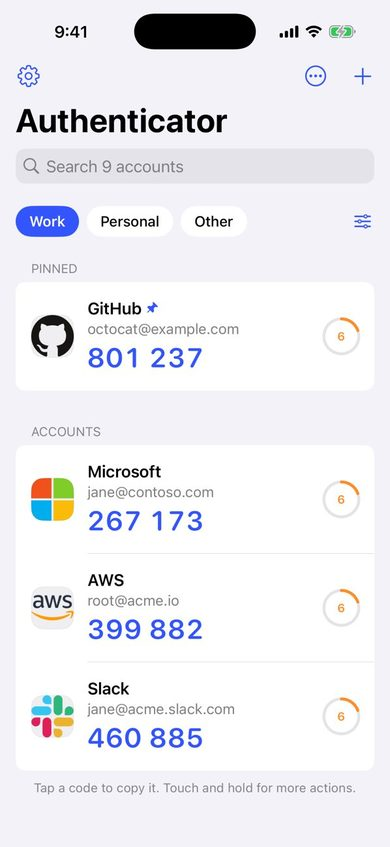
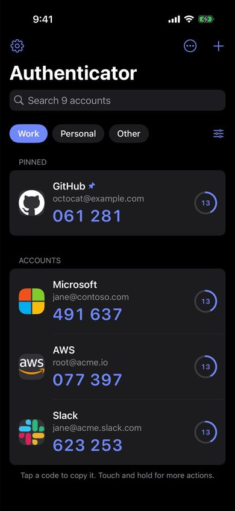
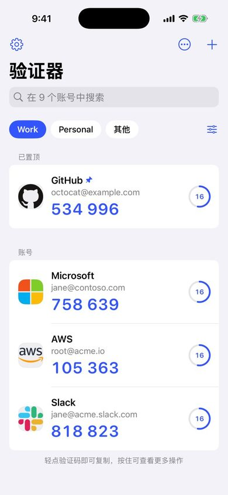
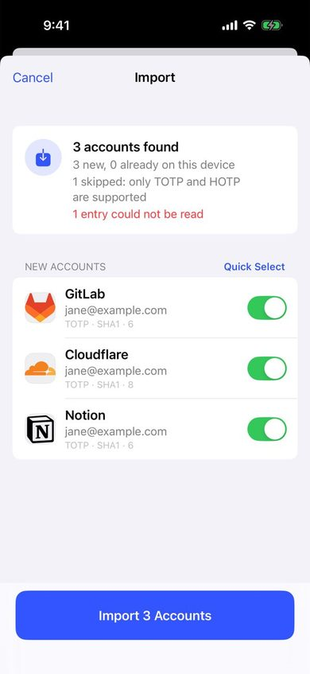
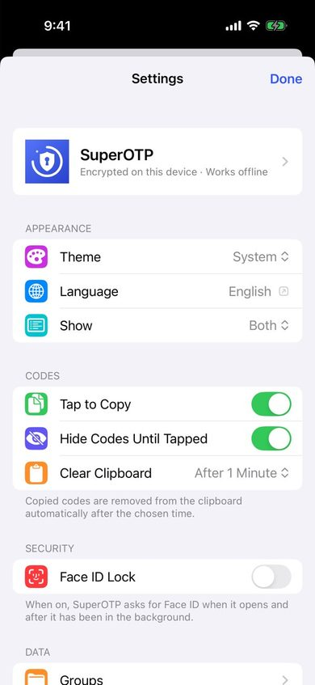
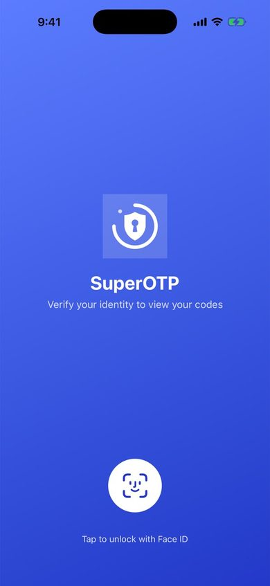

# SuperOTP for iOS

SuperOTP 的 iOS 版本：一个本地加密、离线可用的两步验证（TOTP / HOTP）验证器。功能与
[Android 版](https://github.com/SakuraQH/SuperOTP) 对齐，备份格式与 Android 版和 CloudOTP 互通，
界面和交互按 iOS 的设计规范重新设计。

<p>
  
  
  
</p>
<p>
  
  
  
</p>

## 功能

- **验证码**：TOTP / HOTP，SHA1 / SHA256 / SHA512，6–8 位，自定义周期；倒计时环，最后 10 秒变橙、5 秒变红。
- **添加账号**：扫描二维码、从相册识别（一张图里的多个二维码也能一次导入）、从剪贴板粘贴、手动输入。
  支持 `otpauth://`、Google 身份验证器导出的 `otpauth-migration://` 以及 CloudOTP 的迁移链接。
- **导入预览**：新账号可逐个取消，已存在的账号可选择跳过 / 新增 / 覆盖，确认后才写入。
- **分组**：首页顶部按分组切换，未分组账号在末尾的「其他」里；分组可拖动排序、批量添加账号。
- **整理**：置顶、拖动排序（只影响当前分组内的顺序）、按名称或添加时间排序、搜索、多选批量操作。
- **图标**：72 个内置品牌图标（其中 27 个有深色版本）按服务名自动匹配，也可以用相册图片、网站 favicon 或字母头像。
- **备份与恢复**：CloudOTP 兼容的加密备份（Argon2id + AES-256-GCM）；可保存到「我的 iPhone」或任意文件夹（如 iCloud 云盘），
  支持启动时自动备份、保留份数、导出备份文件、从文件夹或文件恢复。
- **安全**：账号数据用存放在钥匙串（仅本机）的密钥加密；面容 ID / 触控 ID / 密码锁，可设置自动锁定时间；
  切到后台时隐藏内容；复制的验证码会按设置自动从剪贴板清除。
- **语言**：简体中文和英文，跟随系统，也可以在「设置 › SuperOTP › 语言」里单独切换。

## 针对 iOS 的设计调整

| Android 版 | iOS 版 |
| --- | --- |
| 底部弹出的添加面板 | 导航栏 `+` 菜单；空状态里提供「扫描二维码」主按钮 |
| 长按弹出操作面板 | 系统上下文菜单 + 左右轻扫（置顶 / 编辑 / 删除） |
| 自定义多选与排序模式 | 系统编辑模式：勾选圆圈、底部工具栏、拖动手柄 |
| 应用内语言切换 | 系统的按应用语言设置 |
| 选择备份目录（SAF） | 默认保存到「文件 › 我的 iPhone › SuperOTP」，也可选任意文件夹（安全书签） |
| FLAG_SECURE 防截屏 | 进入后台 / 多任务界面时用品牌遮罩覆盖；二维码默认模糊，轻点才显示 |
| — | 复制的验证码可自动过期；支持打开 `otpauth://` 链接直接导入 |
| — | 浅色、深色、着色三种 App 图标 |

## 构建

- Xcode 16 或更新版本，iOS 17.0+（iPhone 与 iPad）
- 打开 `SuperOTP.xcodeproj`，在 *Signing & Capabilities* 里选择自己的开发团队即可运行。
  需要的话把 Bundle Identifier（默认 `app.superotp`）改成自己的。

```bash
# 核心逻辑单元测试（不需要模拟器）
cd Packages/SuperOTPKit && swift test
```

```bash
# 命令行构建（模拟器，不签名）
xcodebuild -project SuperOTP.xcodeproj -scheme SuperOTP -destination 'generic/platform=iOS Simulator' CODE_SIGNING_ALLOWED=NO build
```

GitHub Actions 会在每次推送时运行核心测试并构建 App（`.github/workflows/ios-ci.yml`）。
`Screenshots` 工作流需手动触发：它在模拟器中用演示数据运行 Debug 版并截取主要界面。
Debug 版支持启动参数 `-demoData YES`（填充演示账号）、`-screen settings|backup|groups|edit|import|select`
（直接打开某个界面）以及 `-hideCodes NO`、`-theme dark` 等设置覆盖，Release 版不包含这些代码。

## 项目结构

```
Packages/SuperOTPKit/     与平台无关的核心（可单独测试）
  Sources/CArgon2/        Argon2id + BLAKE2b（C 实现，调试构建下也足够快）
  Sources/SuperOTPKit/    模型、Base32、HOTP/TOTP、链接解析、导入计划、CloudOTP 备份、图标匹配、数据模型
  Tests/                  RFC 4226 / 6238 / 9106 测试向量，以及用独立实现（Python）加密的备份解密测试
SuperOTP/                 SwiftUI App
  Model/                  加密存储（钥匙串 + AES-GCM）、设置、应用锁、备份目录、图标缓存
  Views/                  首页、编辑、扫码、导入预览、分组、设置、备份与恢复
  Components/             品牌色、Logo、账号图标等通用组件
  BrandIcons.xcassets     内置品牌图标（含深色版本）
  Localizable.xcstrings   中英文文案
scripts/                  文案表生成脚本（strings_zh.py 为中文翻译）
```

修改界面文案后，在 `scripts/strings_zh.py` 里补上中文，再运行 `python3 scripts/make_strings.py`
重新生成 `Localizable.xcstrings`；脚本会列出缺少翻译的文案。

## 数据与兼容性

- 备份文件格式：`CloudOTP-Backup-Encrypt-V01` 头 + 16 字节盐 + 12 字节 IV + AES-256-GCM 密文，
  密钥由 Argon2id（v1.3，t=3，m=64 MiB，p=1）从备份密码派生。与 Android 版 SuperOTP、CloudOTP 互相可读。
- 账号数据只保存在本机，不随 iCloud 设备备份迁移；换机请使用加密备份。
- 唯一的网络请求是你主动获取网站图标时访问 `https://<域名>/favicon.ico`。
